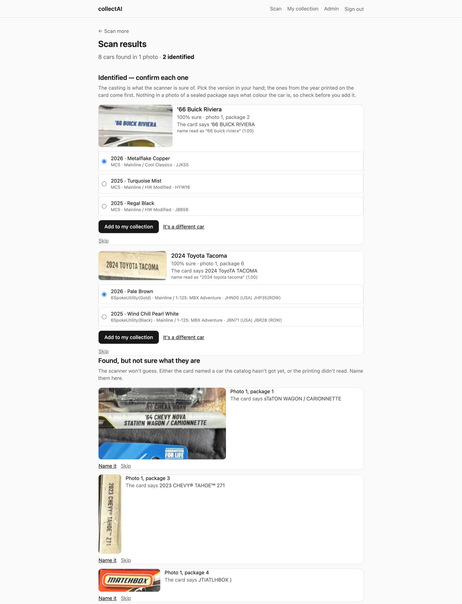
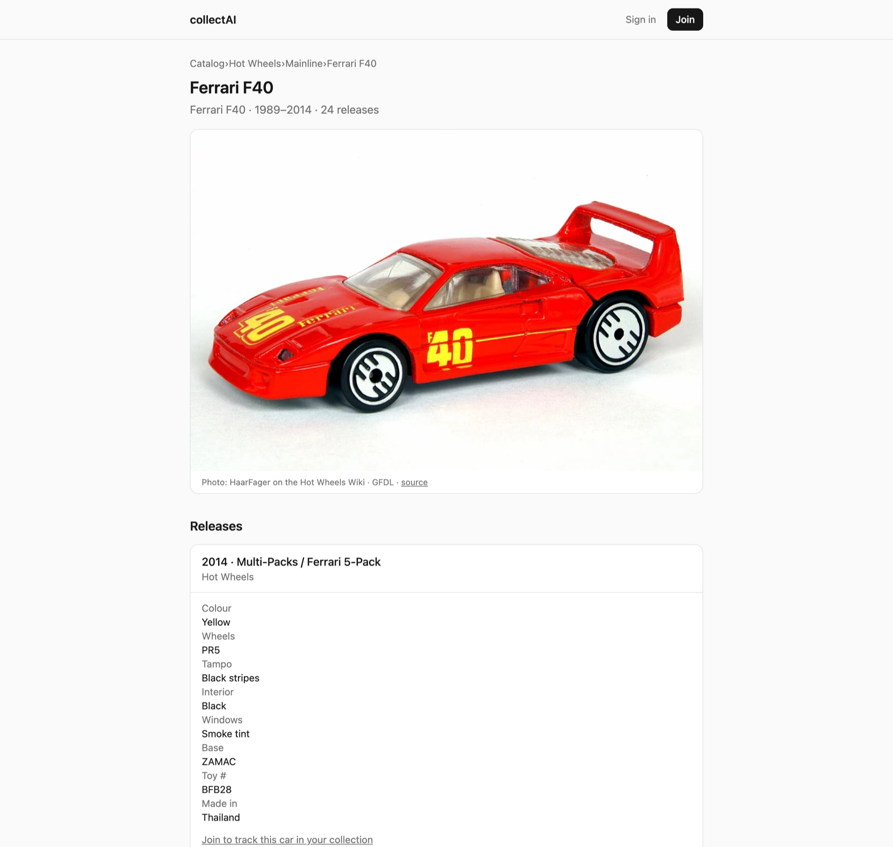
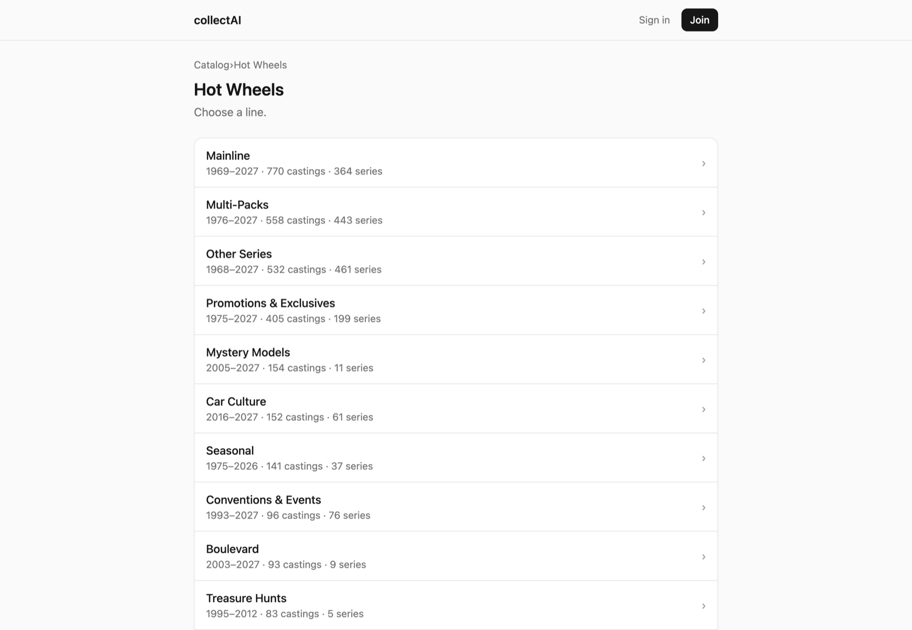

# collectAI

A diecast catalog — Hot Wheels, Matchbox, Tomica, Mini GT — that fills itself
from public wiki dumps, reads cars off photographs on its own hardware, and
publishes nothing until a person has approved it.

Laravel 13 and Postgres, with a standalone Python recognition service. 6,819
castings imported from four sources, 406 tests. Live at
[collectai.club](https://collectai.club) behind an email-gated login while it's
in development, so that link won't open without an invitation.



*Eight packaged cars found in one photo. Two are named with their evidence
attached; the other six are reported as found rather than guessed at.*



*One casting, every release under it, and the attributes that make a variation
its own record.*



*A classifier sorts 4,240 imported Hot Wheels series into sixteen named lines —
a taxonomy the wikis don't publish.*

## What's worth a look

**Recognition that calls nobody.** OpenCV and Tesseract find the cars and read
their printing; a DINOv2-small encoder exported to ONNX does the visual match.
The service reads one exported JSON index and never touches the database, so it
runs anywhere. A Claude-API driver exists, but `CATALOG_AI_DRIVER=local` is the
default and the deployed site depends on no outside model.

**Provenance is the gate.** Every imported record is keyed to the wiki page and
table row it came from, which is what makes a re-import update instead of
duplicate. Facts the wiki states go live; the one thing it never states — which
real car a casting represents — is inferred separately and held for review.

**Approval can't be routed around.** Rows default to `pending`, `status` isn't
mass-assignable on any model, and approving one record promotes its whole
ancestor chain in a single transaction. A real casting with no model attached
raises rather than publishing, which is why 3,213 of the 6,819 castings are
public and the rest still wait on a person.

**Measured, not claimed.** "Can the model recognise a car through its blister
packaging?" is answered *no*, with numbers: padding a card out with the carpet
it's lying on costs 60 points of top-1 accuracy, while angle, light and
distance cost between nothing and twelve. Two candidate fixes were built,
measured, and thrown away.

## Stack

| | |
|---|---|
| Web | Laravel 13, PHP 8.3+, Blade, Tailwind 4 |
| Data | PostgreSQL 16 (`pg_trgm`, `jsonb`, expression unique indexes), Redis |
| Recognition | Python, OpenCV, Tesseract, ONNX Runtime, DINOv2-small |
| Infra | Docker, nginx + php-fpm, Railway, Supabase, Cloudflare R2 |
| Clients | PWA, plus an iOS shell via Capacitor |

## Numbers

| | |
|---|---|
| Catalog | 6,819 castings · 38,266 releases · 51,239 variations |
| Visual model | 62,149 photos · 15,796 castings |
| Top-1 / top-5 on 8,236 held-out versions | 73.3% / 85.2% |
| Visual-only answers, where thresholds allow one | 95.1% precise at 25.5% coverage |
| Tests | 406 PHP (against Postgres, not SQLite) · 91 Python |

The split holds out whole versions, so a car is tested on a colour it never saw
in training. Those are studio photos; accuracy on a phone photo of a loose car
is still unmeasured, and the docs say so wherever it comes up.

## Run it

```bash
./collectai setup
```

Writes `.env`, builds the containers, migrates, creates an admin and compiles
the assets — then it's on `localhost:8000`. `./collectai import` fills it from
the wiki dumps in about twenty minutes, and `./collectai help` lists the rest.

## Detail

[instructions/README.md](instructions/README.md) is the full manual.
[CLAUDE.md](CLAUDE.md) carries the decisions and the measurement behind each
threshold. Data sources are licence-checked rather than scraped: CC-BY-SA wiki
facts, wiki photos only where the file itself permits reuse, and written
permission on file for the training sources.
